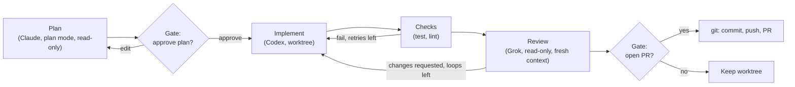
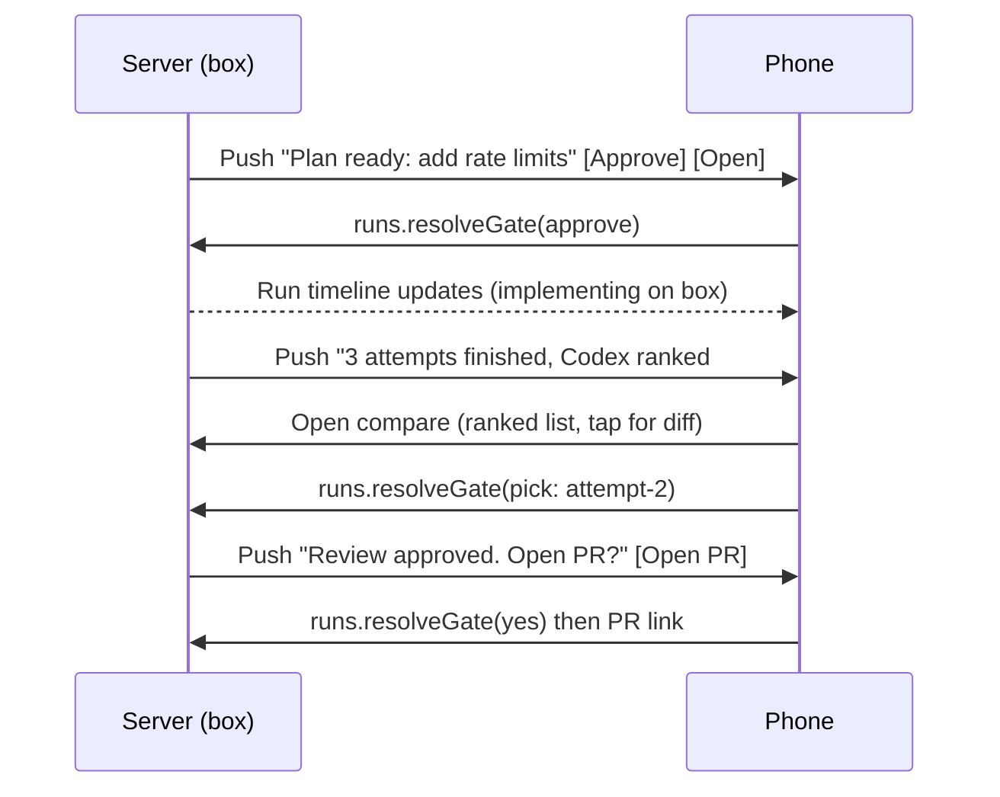
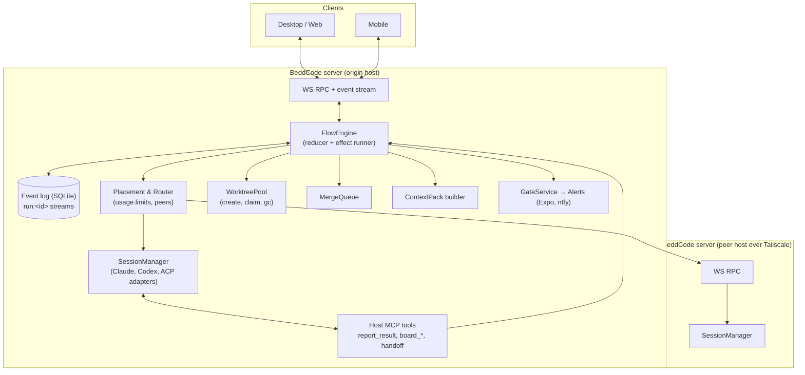
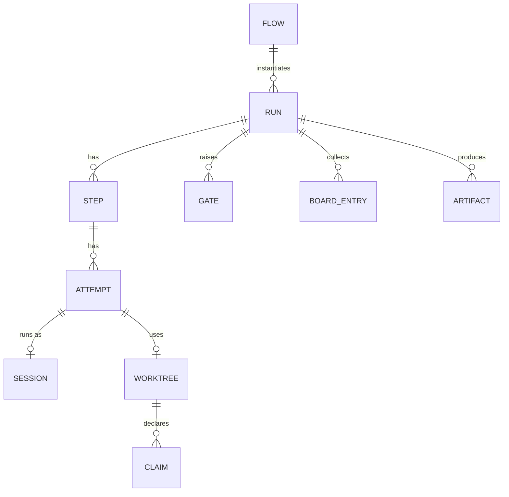

# PRD: Agent orchestration (Flows)

Status: proposal, not started. Owner: 0xbasinas. Last updated: 24 October 2026.

This doc is for future work. Nothing here exists yet unless a section says it ships today.

## Executive summary

BeddCode can already start one agent from another. Host tools (`start_session`, `send_message`,
`wait_for`, `read_transcript`, `stop`, `list_children`) let a session start child sessions, up to 2
levels deep, with at most 5 running and 10 in total per parent. Children show up nested under the
parent. That is a good primitive. It is not a product: the parent agent invents the workflow in its
own prompt every time, nothing records the plan, and the user has to watch a desktop to steer it.

This PRD proposes **Flows**. A Flow is a small, declarative, durable workflow over real agent
sessions. The server runs it, records it in the event log, and shows it on desktop and phone. Flows
are built from steps BeddCode already knows how to run: sessions, worktrees, checkpoints, git, PRs,
schedules and alerts.

What makes this different from the field:

1. **Cross-provider by default.** Claude Code plans, Codex implements, Grok (ACP) reviews. Claude's
   agent teams are Claude-only, and Codex subagents are Codex-only. BeddCode already normalizes all
   three behind one event model.
2. **Durable ledger, not chat.** Every step, attempt, gate and artifact is an event in SQLite. A
   restart, a crash or a closed laptop does not lose the run. Existing harnesses keep their state in
   prompts or in a magic token (see Ralph in [Landscape](#landscape)).
3. **Phone-first decisions.** Plan approval, the pick in a best-of-N race, and "merge or not" are
   gates. Each gate is a push notification with one-tap answers, using the Expo push and ntfy alerts
   that already exist.
4. **Laptop and box are one pool.** A step can run on any paired BeddCode host over Tailscale. The
   choice depends on where the repo is, which providers are signed in, and load.
5. **Worktree-native safety.** Each writer gets its own worktree, a checkpoint, a diff and an undo.
   File claims and a merge queue prevent the "two agents edited the same file" problem. Claude's docs
   tell you to avoid that problem rather than solve it.

**P0 (first release):**

- The Flow engine and run ledger.
- The plan → implement → review pipeline, with a reviewer gate before PR.
- Best-of-N races with checks, a judge and a human pick.
- Gates in the phone inbox.
- Structured handoff with context packs.

**P1:**

- Conflict-aware parallel worktrees and a merge queue.
- Cross-host placement.
- Budget-aware routing.
- Repo recipes (`.beddcode/flows/*.yaml`).
- A shared run board.

**P2:**

- A watchdog agent.
- Flow evals across providers.
- Exposing Flows to outside orchestrators (MCP first, A2A later).

## Goals and non-goals

**Goals**

- Turn the common multi-agent patterns into one-click, repeatable runs. The patterns are: plan then
  build, try N ways, build then review, and split work then merge.
- Keep the human as the merge authority. Make each decision fast from a phone.
- Survive restarts, network drops and provider failures without losing work or duplicating it.
- Stay provider-neutral. Work with Claude Code, Codex and any ACP agent (Grok, Gemini, OpenCode),
  using only what each adapter already exposes.
- Reuse what exists: sessions, worktrees, `sessions.fork`, `turnDiff`/`undoTurn`, `git.*`,
  `git.pr.*`, schedules, alerts, push, `usage.limits`, `tailnet.peers`.

**Non-goals**

- No role-play "company" simulations (the MetaGPT, ChatDev and CrewAI style). The research found
  high token cost and weak git isolation (see [Landscape](#landscape)).
- No automatic merge to `main`, ever. Merges into an integration branch are allowed behind a gate.
- No BeddCode permission system. Agent approvals are still relayed from each provider (PLAN.md).
  Flows add **gates**, which are workflow decisions, not tool permissions.
- No cloud runners in this PRD. E2B, Daytona and Cursor-style VMs could later be a host type.
- macOS stays out of scope (PLAN.md).

## Who this is for

One developer runs Claude Code, Codex and Grok across a Windows laptop and a Linux box joined by
Tailscale. They start work at the desk and want to keep it moving from a phone. They pay for
subscriptions that have usage windows, so which provider does what matters.

## What exists today

| Capability                     | Where                                                                                            | Notes                                                                                                                                                     |
| ------------------------------ | ------------------------------------------------------------------------------------------------ | --------------------------------------------------------------------------------------------------------------------------------------------------------- |
| Agent tools                    | `apps/server/src/automation/agentTools.ts`                                                       | `MAX_DEPTH = 2`, `MAX_ACTIVE_CHILDREN = 5`, `MAX_TOTAL_CHILDREN = 10`. `wait_for` max is 240 s per call. A child can't get a looser mode than its parent. |
| Nested sessions                | session `origin.parent`                                                                          | Children are grouped under the parent in the sidebar and in tool cards.                                                                                   |
| Worktrees                      | `sessions.create` with a worktree, `worktrees.remove`                                            | One checkout per session.                                                                                                                                 |
| Checkpoints                    | `sessions.turnDiff`, `sessions.undoTurn`, `turn.changes`, `turn.reverted`                        | Per-turn diff and undo.                                                                                                                                   |
| Fork                           | `sessions.fork`                                                                                  | A new session from an existing transcript.                                                                                                                |
| Git and PRs                    | `git.generate`, `git.commit`, `git.push`, `git.pr.create`, `git.pr.list`/`view`/`act`/`checkout` | PR creation and review from the git pane.                                                                                                                 |
| Schedules                      | `apps/server/src/automation/schedules.ts` (`schedules.json`)                                     | Cron runs that start sessions.                                                                                                                            |
| Alerts                         | `apps/server/src/automation/alerts.ts`                                                           | Expo push to phones and an ntfy topic. Kinds: `turnDone`, `needsYou`, `error`, `schedule`.                                                                |
| Usage                          | `usage.summary`, `usage.limits`                                                                  | Per-provider usage and limit windows, where the provider reports them.                                                                                    |
| Hosts                          | `tailnet.peers`, `host.pair`, `devices.*`                                                        | Multi-host over Tailscale. Pairing guard.                                                                                                                 |
| Browser use (PR #5, in review) | `apps/server/src/automation/browserUse.ts`                                                       | The host MCP server routes `browser_*` tools to a desktop client. This is the pattern for new host tools.                                                 |

## Landscape

Short version of `/workspace/research/landscape.md` plus fresh checks. Where a fact was not verified,
it says so.

| System                               | What it does for orchestration                                                                                                                                                                                                                         | What we take                                                                                               | Source                                                                                            |
| ------------------------------------ | ------------------------------------------------------------------------------------------------------------------------------------------------------------------------------------------------------------------------------------------------------ | ---------------------------------------------------------------------------------------------------------- | ------------------------------------------------------------------------------------------------- |
| Claude Code agent teams              | Experimental and off by default. A shared task list plus mailboxes. Hooks `TeammateIdle`, `TaskCreated`, `TaskCompleted`. One team per session, no nested teams. Teammates are not restored by `/resume` or `/rewind`. The docs suggest 3–5 teammates. | Claimable tasks, idle hooks, a small team size                                                             | [docs](https://code.claude.com/docs/en/agent-teams)                                               |
| Claude Code teammate worktrees       | Reported: worktree isolation is not applied to teammates.                                                                                                                                                                                              | Isolation must be ours, not the provider's                                                                 | [issue #50280](https://github.com/anthropics/claude-code/issues/50280)                            |
| Claude Code subagents                | `.claude/agents/*.md` with `tools`, `model`, `permissionMode`, `maxTurns`, `isolation`                                                                                                                                                                 | Role presets as data                                                                                       | [docs](https://code.claude.com/docs/en/sub-agents)                                                |
| Codex subagents                      | In-process threads. `agents.max_threads` defaults to 6.                                                                                                                                                                                                | A concurrency cap                                                                                          | [docs](https://developers.openai.com/codex/subagents)                                             |
| Codex app worktrees                  | Managed worktrees start detached and get a branch at handoff. `.worktreeinclude` copies ignored files.                                                                                                                                                 | A detached-first race, `.worktreeinclude`                                                                  | [docs](https://developers.openai.com/codex/app/worktrees)                                         |
| Codex cloud                          | `codex cloud exec --attempts 1..4`, then diff or apply a chosen attempt                                                                                                                                                                                | Best-of-N with N ≤ 4                                                                                       | [cli.rs](https://github.com/openai/codex/blob/35aaa5d9/codex-rs/cloud-tasks/src/cli.rs)           |
| Paseo                                | Agents create worktrees and other agents across providers. Prompt-driven "implement then review", heartbeats, remote host from the CLI. A `/paseo-handoff` skill.                                                                                      | Closest sibling. It is prompt-driven, so its workflows live in chat, not in a ledger.                      | [repo](https://github.com/getpaseo/paseo)                                                         |
| Synara                               | Gateway tools `synara_create_threads` (1–20), wait capped at 60 s. Same-thread provider handoff with a 32k bootstrap budget. Forks. A `computer:control` capability on gateway tokens.                                                                 | Bounded handoff packs, capability-scoped tokens                                                            | [repo](https://github.com/Emanuele-web04/synara)                                                  |
| Conductor                            | A Mac app that runs Claude Code, Codex and others in parallel worktrees, with diffs, checks and merge                                                                                                                                                  | The worktree-per-task UX bar                                                                               | [docs](https://www.conductor.build/docs)                                                          |
| Sculptor (Imbue)                     | Parallel agents in worktrees or containers, with merge-conflict help                                                                                                                                                                                   | Containers as an optional isolation level                                                                  | [product](https://imbue.com/product/sculptor/)                                                    |
| Amp                                  | An "Oracle" read-only reasoning subagent for review and planning, and a "Librarian" for code search                                                                                                                                                    | Read-only reviewer roles                                                                                   | [Oracle](https://ampcode.com/news/oracle), [tools](https://ampcode.com/docs/tools)                |
| Vibe Kanban                          | Executors, a worktree mutex, spawning a review. The product is sunsetting.                                                                                                                                                                             | A per-path worktree lock                                                                                   | [repo](https://github.com/BloopAI/vibe-kanban)                                                    |
| Goose                                | In-process subagents with `DEFAULT_SUBAGENT_MAX_TURNS = 25`                                                                                                                                                                                            | A turn cap per child                                                                                       | [repo](https://github.com/aaif-goose/goose)                                                       |
| Ralph loop                           | A bash loop of fresh agent runs. It stops when stdout contains `<promise>COMPLETE</promise>`.                                                                                                                                                          | A fresh process per attempt. Warning: a completion token is not a ledger.                                  | landscape.md §3.8                                                                                 |
| CrewAI, AutoGen, MetaGPT, Agents SDK | In-process LLM-call orchestration (roles, group chat, handoff functions)                                                                                                                                                                               | The LangGraph-style idea of checkpointed state, explicit edges and human interrupts. Not the role chatter. | landscape.md §5                                                                                   |
| A2A                                  | An open, Linux Foundation protocol for agent-to-agent tasks: `SendMessage`, `GetTask`, `CancelTask`, over JSON-RPC, gRPC or REST. v1.0.                                                                                                                | A future outside interface (P2)                                                                            | [spec](https://a2a-protocol.org/latest/specification/), [repo](https://github.com/a2aproject/A2A) |

Patterns that held across real systems:

- Worktrees are the local isolation primitive.
- The human is the merge.
- Runaway control means caps: turns, attempts, time, team size, spend.
- State must live outside the worker checkout.

## Features

### P0-1 Flow engine and run ledger

A **Flow** is a template, a small DAG of steps. A **Run** is one execution of it. The server owns the
run. Agents do not.

Step kinds:

| Kind      | What it does                                                                                                                                                                                                                                    |
| --------- | ----------------------------------------------------------------------------------------------------------------------------------------------------------------------------------------------------------------------------------------------- |
| `session` | Start or continue an agent session with a prompt, an agent/model/mode, a workspace (`local`, `worktree`, or `inherit:<step>`) and a host. The step ends when the turn completes **and** the agent called `report_result`, or when it times out. |
| `race`    | Run N `session` attempts with the same input, each in its own worktree.                                                                                                                                                                         |
| `check`   | Run a project script (test, lint, build) in a step's workspace. Records exit code and log tail.                                                                                                                                                 |
| `judge`   | An agent session that scores attempts against a rubric and returns structured scores.                                                                                                                                                           |
| `gate`    | Wait for a human decision. Options are typed: approve/reject, pick one of N, or free text.                                                                                                                                                      |
| `git`     | Commit, push, PR create, or merge into an integration branch. These map to the existing `git.*` RPCs.                                                                                                                                           |
| `handoff` | Build a context pack from earlier steps and feed it to the next `session`.                                                                                                                                                                      |

Rules:

- **Structured completion.** Agents in a Flow get a `report_result` host tool with
  `{status: 'done'|'blocked'|'failed', summary, artifacts?, next?}`. If a turn ends without calling
  it, the step counts as done only if the step allows `implicitDone`. Otherwise the engine re-prompts
  once, then marks the step `needs_attention`. This avoids Ralph's "say the magic word" failure.
- **Deterministic engine.** Run state is a pure reduction over run events. A restart replays them.
  Side effects (start a session, run a script, push) are idempotent and keyed by `stepId:attempt`.
- **Built-in templates for P0:** `plan-build-review`, `race`, `review-pr`, `fix-ci`.

### P0-2 Plan → implement → review, with a reviewer gate



- The planner runs in the most restrictive mode its provider has (Claude plan mode, Codex
  read-only, the read-only mode an ACP agent advertises). The plan comes out as `plan.updated` and
  `report_result.summary`.
- The reviewer runs on a **different provider** by default, with a fresh conversation. Its input is
  a context pack: the goal, the approved plan, the diff, and the check results. Its output is a
  verdict (`approve`, `request_changes`) plus findings tied to file and line.
- There is a review loop cap (default 2) and a check retry cap (default 2). After those, the run
  goes to a gate. It does not keep spinning.
- The "open PR?" gate shows the diff summary, checks and reviewer verdict. One tap pushes the branch
  and runs `git.pr.create` with a generated body.

### P0-3 Best-of-N race with judging

- N is 2–4. The cap of 4 matches Codex cloud attempts. Attempts can mix providers ("Claude vs Codex
  vs Grok") or reuse one provider with different models.
- Each attempt gets a detached worktree from the same base commit (the Codex app pattern). A branch
  is made only for the winner.
- After the attempts, `check` runs for each one, then a `judge` session gets every diff, check result
  and the rubric. The judge returns a ranking with reasons. The judge never wrote code in this run.
- A gate shows a compare view on desktop: side-by-side diffs, checks, judge notes, tokens and time.
  On the phone it shows a ranked list. The user picks one, or asks for "merge the best parts". That
  starts a follow-up `session` with the picked diff plus a cherry-pick list.
- Losing worktrees are kept for 24 h by default, then removed with `worktrees.remove`. Their
  transcripts stay.

### P0-4 Phone gates and a decision inbox

- A new alert kind, `gate`, uses the existing Expo push and ntfy delivery. The notification carries
  the run title, the question and up to 3 quick actions (Approve, Reject, Open).
- The mobile app gets an **Inbox** tab. It lists every open gate across hosts, provider approvals
  (`approval.requested`) and questions (`question.requested`), sorted by age, one per row.
- Gates have optional timeouts with a default action. The default action can only be the safe one:
  `reject` or `pause`. It can never be `approve`.
- Gate answers go through the same paired-device auth as everything else. No new channel.

### P0-5 Handoff with context packs

A **context pack** is a bounded, structured summary. The server builds it from the ledger. A model
does not write it from memory.

```text
goal, constraints, decisions (from gates), plan,
diff stat + key hunks (budgeted), check results, open todos,
files touched, links to source sessions/turns
```

- The default budget is 24k characters. It can be set per step. Synara uses a 32k bootstrap budget
  for the same job.
- Used by `handoff` steps, by reviewers and judges, and by a new **Hand off** button on any session:
  pick an agent, and BeddCode starts a new session with the pack in the same worktree. This is the
  Paseo `/paseo-handoff` and Synara handoff idea, built from the ledger.
- The source session stays read-only after the handoff, so two agents never write the same worktree
  at once.

### P1-1 Conflict-aware parallel worktrees and a merge queue

- **Split step.** A planner returns `tasks[]`, each with `files?` (predicted paths or globs). The
  engine starts one worktree session per task, up to the active-children cap.
- **Claims.** Predicted files become soft claims. Each `turn.changes` event updates the actual
  touched set. When two tasks touch the same path, the board flags it. The later task gets a
  `send_message` warning and the user sees an overlap badge. Claims are hints, not locks. Worktrees
  stop checkout races. They do not stop semantic conflicts (landscape.md §6).
- **Merge queue.** Finished tasks join a queue that targets an integration branch
  (`flow/<run-id>`). For each item, the engine merges with `--no-ff`, runs checks, and on a conflict
  starts a short "resolve conflict" session in a fresh worktree. If that fails, it raises a gate.
  The integration branch reaches `main` only through a PR.

### P1-2 Cross-host placement

- Each step has `host: auto | <hostId>`. `auto` scores the peers from `tailnet.peers` that run
  BeddCode and are paired. The score uses: whether the repo exists there (same remote URL), whether
  the provider is signed in, the number of active sessions, and the OS when a step needs it (for
  example "Windows build").
- The originating host owns the run ledger. It drives remote steps as a client of the peer's RPC,
  with a host-to-host token (see [Open questions](#open-questions)). Remote session events are
  mirrored into the run as references, not copied wholesale.
- A peer that goes offline mid-step marks the step `host_lost`. The engine waits up to the step's
  grace period (default 10 min), then offers a gate: retry elsewhere or wait.

### P1-3 Budget- and usage-aware routing

- Agent selectors can be abstract: `role: planner|implementer|reviewer|judge`, plus a preference
  list such as `[claude, codex, grok]`.
- At step start, the router reads `usage.limits`. It skips a provider whose window is above a
  threshold (default 85%) and picks the next one. The choice and the reason go into the ledger.
- Per-run budgets: max wall time (default 2 h), max sessions (default 12), max tokens when the
  provider reports usage. When a budget is crossed, the run pauses with a gate. Nothing is killed
  silently.

### P1-4 Recipes

- Flows are YAML in `.beddcode/flows/` (versioned with the repo) or in the user config (global).
- Slash commands: `/flow <name> <args>` in any composer. `/flows` lists them.
- Schedules can start a Flow instead of a plain prompt. Example: a nightly `fix-ci` on `main`, with
  a gate before the PR.

```yaml
name: plan-build-review
inputs: { task: string }
steps:
  - id: plan
    session: { role: planner, mode: plan, workspace: local, prompt: 'Plan: {{task}}' }
  - id: approve
    gate: { ask: 'Approve the plan?', show: plan, timeout: 12h, default: pause }
  - id: build
    session: { role: implementer, workspace: worktree, prompt: handoff(plan, approve) }
  - id: test
    check: { script: test, in: build, retry: { step: build, max: 2 } }
  - id: review
    session:
      { role: reviewer, mode: read-only, workspace: inherit:build, prompt: handoff(build, test) }
    loop: { back_to: build, while: review.verdict == 'request_changes', max: 2 }
  - id: ship
    gate: { ask: 'Open a PR?', show: [build.diff, test, review] }
  - id: pr
    git: { pr: create, from: build }
```

### P1-5 Shared run board

- Every run has a **board**: an append-only list of notes, findings, claims and artifacts. Agents
  use host tools `board_post` and `board_read`. The UI shows it as a side panel.
- This replaces mailbox chatter between agents. Agents never message each other freely. They post to
  the board, and the engine decides who sees what in their next context pack.

### P2 ideas

- **Watchdog.** A cheap agent on a timer reads stuck runs. A step counts as stuck when it has made
  no events for N minutes, or when the same tool fails 3 times. The watchdog can nudge with
  `send_message` or raise a gate. It never edits code.
- **Flow evals.** Re-run a recipe across providers on a fixed task set. Store pass rate, time and
  tokens. This gives a personal leaderboard that feeds the router.
- **Outside interfaces.** Expose `flows.start`, `runs.get` and `runs.cancel` as MCP tools for outside
  agents. Later, add an A2A agent card that maps an A2A task to a Run (`SendMessage` → `runs.start`,
  `GetTask` → `runs.get`, `CancelTask` → `runs.cancel`).
- **Computer-use steps.** A step can ask for a desktop (see [computer-use.md](./computer-use.md)),
  for example "verify the UI on Windows".

## User stories

| ID    | Priority | Story                                                                                                                                                          |
| ----- | -------- | -------------------------------------------------------------------------------------------------------------------------------------------------------------- |
| US-1  | P0       | As a dev, I run `/flow plan-build-review "add rate limits to the API"`. I approve the plan from my phone on the bus, and I get a PR link when review passes.   |
| US-2  | P0       | As a dev, I race Claude, Codex and Grok on a hard bug. I see a ranked compare view with checks and judge notes, and I pick the winner with one tap.            |
| US-3  | P0       | As a dev, when a session gets stuck I press **Hand off → Codex**. The new agent continues in the same worktree with a clean summary, not the whole transcript. |
| US-4  | P0       | As a dev, I see every waiting decision (gates, provider approvals, questions) across laptop and box in one phone inbox.                                        |
| US-5  | P0       | As a dev, if the server restarts mid-run, the run resumes and does not start duplicate sessions.                                                               |
| US-6  | P1       | As a dev, I split a feature into 3 tasks in parallel worktrees, get warned when two touch the same file, and land them through a merge queue onto one branch.  |
| US-7  | P1       | As a dev, heavy steps run on the box while my laptop sleeps. The run still shows on my phone.                                                                  |
| US-8  | P1       | As a dev, when my Claude window is at 90%, review steps go to Codex automatically and the run shows why.                                                       |
| US-9  | P1       | As a dev, I commit `.beddcode/flows/release-check.yaml` and run it from a schedule every night.                                                                |
| US-10 | P2       | As a dev, I compare which provider fixes my repo's bugs best over the last month.                                                                              |

## UX

### Desktop

- **Start.**
  - `/flow` in the composer opens a picker with recipes and inputs.
  - A **Run as Flow** item in the send menu wraps the current prompt in `plan-build-review`.
  - The sidebar gets a **Runs** section above sessions.
- **Run view.** This is a new main-area pane, like the browser or git panes.
  - Top: a horizontal step graph. Each node shows status, agent icon, host badge, time and tokens.
  - Click a node to open its session in the thread view. The existing nested tool cards still work.
  - Right panel: tabs for Board, Gates and Artifacts (diffs, check logs, PR).
  - Header: Pause, Resume, Cancel run (stops every descendant session and keeps worktrees), budget
    meters.
- **Compare view (race).** 2–4 columns. Each column shows a diff stat, check badges, the judge
  score and reason, and an Open diff button. Actions: Pick, Merge best parts, Reject all.
- **Gate card.** Shows inline in the parent thread and in the run view. It has the question,
  evidence (plan or diff or verdict) and typed buttons.

### Mobile



- The **Inbox** tab comes first. **Runs** shows a list, then a vertical timeline per run. Mobile has a
  diffstat and an approval card today. A full diff view on mobile is new work. Board and gate evidence are read-only.
- Quick actions in a notification resolve the gate without opening the app, where the platform
  allows it. Free-text gates always open the app.

## Architecture



### Components

| Component                | Responsibility                                                                                                                                             | Builds on                                      |
| ------------------------ | ---------------------------------------------------------------------------------------------------------------------------------------------------------- | ---------------------------------------------- |
| `FlowEngine`             | Loads a template, validates it into a DAG, reduces run events into state, and schedules ready steps. Runs side effects through idempotent effect handlers. | Event log, schedules' tick loop                |
| `FlowStore`              | Templates from `.beddcode/flows/*.yaml` and the user config. Zod-validated. Hot reload.                                                                    | `files.*`, watcher                             |
| `Placement` and `Router` | Picks the host and agent per step. Records the reason.                                                                                                     | `tailnet.peers`, `usage.limits`, `agents.list` |
| `WorktreePool`           | Creates detached or branched worktrees, copies `.worktreeinclude` files, tracks claims from `turn.changes`, and garbage-collects.                          | Existing worktree code, `worktrees.remove`     |
| `CheckRunner`            | Runs project scripts in a worktree using the terminal manager. Captures the exit code and log tail.                                                        | `projects.setScripts`, terminals               |
| `ContextPackBuilder`     | Builds bounded packs from the ledger, diffs and checks.                                                                                                    | `turnDiff`, `git.diff`                         |
| `GateService`            | Opens gates, delivers them through alerts and push, applies timeouts with safe defaults.                                                                   | `alerts.ts`, push                              |
| `MergeQueue`             | Serializes merges into `flow/<run>`. Checks after each merge. Conflict sessions.                                                                           | `git.*`                                        |
| `PeerClient`             | A host-to-host RPC client for remote steps, with reconnect and event mirroring.                                                                            | Client-runtime WS code                         |
| Host tools               | `report_result`, `board_post`, `board_read`, `claim_files`, `request_handoff`. Only offered to sessions inside a run.                                      | `agentTools.ts` MCP server                     |

### Data model

The event log stays the source of truth. Runs get their own stream key (`run:<id>`), so the session
streams are unchanged. Projections live in new tables for fast lists.



| Entity        | Key fields                                                                                                                                                                          |
| ------------- | ----------------------------------------------------------------------------------------------------------------------------------------------------------------------------------- |
| `Flow`        | `id`, `name`, `source` (`repo`, `user`, `builtin`), `version` (content hash), `inputs` schema, `steps[]`                                                                            |
| `Run`         | `id`, `flowId`, `flowVersion`, `projectId`, `originHostId`, `inputs`, `status` (`running`, `paused`, `waiting_gate`, `done`, `failed`, `cancelled`), `budget`, `usage`, `createdAt` |
| `Step`        | `runId`, `stepId`, `kind`, `status`, `deps[]`, `loopCount`, `startedAt`, `endedAt`, `result`                                                                                        |
| `Attempt`     | `stepId`, `n`, `hostId`, `agentId`, `model`, `sessionId`, `worktreeId`, `routeReason`, `report` (from `report_result`), `score?`                                                    |
| `Gate`        | `id`, `runId`, `stepId`, `question`, `kind` (`approve`, `pick`, `text`), `options`, `evidenceRefs`, `timeoutAt`, `defaultAction`, `resolvedBy` (`deviceId`), `answer`               |
| `BoardEntry`  | `runId`, `author` (`sessionId` or `user`), `type` (`note`, `finding`, `claim`, `artifact`), `body`, `refs`                                                                          |
| `Worktree`    | `id`, `hostId`, `path`, `baseSha`, `branch?`, `claims[]`, `touched[]`, `gcAfter`                                                                                                    |
| `ContextPack` | `id`, `runId`, `forStep`, `budget`, `sections[]`, `sourceRefs` (stored, so reviewers see exactly what was sent)                                                                     |

### Contracts

New RPCs in `packages/contracts`. Names follow the existing `noun.verb` style.

| RPC                                          | Params → Result                                                            |
| -------------------------------------------- | -------------------------------------------------------------------------- |
| `flows.list`                                 | `{projectId}` → `Flow[]`                                                   |
| `flows.save` / `flows.remove`                | user-scope templates only. Repo templates are edited as files.             |
| `flows.validate`                             | `{yaml}` → `{ok, errors[], graph}`                                         |
| `runs.start`                                 | `{flowId \| inline, projectId, inputs, hostPolicy?, budget?}` → `{runId}`  |
| `runs.list` / `runs.get`                     | filters → summaries / a full projection                                    |
| `runs.pause` / `runs.resume` / `runs.cancel` | `{runId}`. Cancel stops every descendant session and keeps worktrees.      |
| `runs.resolveGate`                           | `{runId, gateId, answer}` → `{ok}`                                         |
| `runs.retryStep`                             | `{runId, stepId, hostId?, agentId?}`                                       |
| `sessions.handoff`                           | `{sessionId, toAgentId, budget?}` → `{sessionId}`. Also used outside runs. |

New events on the `run:<id>` stream:

```text
run.created  run.status  step.ready  step.started  step.completed  step.failed
attempt.started  attempt.reported  attempt.scored  check.completed
gate.opened  gate.resolved  gate.expired  board.posted  claim.overlap
merge.queued  merge.completed  merge.conflict  budget.warning  budget.exceeded
host.lost  host.recovered
```

Sessions started by a run carry `origin: {run: {runId, stepId, attempt}}` next to the existing
`parent` origin. That lets the sidebar, alerts and the existing "don't alert on child `turnDone`"
rule treat them correctly.

### Reusing agent tools

The current `start_session`/`wait_for` tools stay. They are the ad-hoc path. Flows are the planned
path, and both share the same caps. One new tool, `start_flow`, lets an agent start a recipe as a
child run. That run counts toward the parent's `MAX_TOTAL_CHILDREN`, and its depth is
`parent.depth + 1`.

## Safety limits

| Limit                   | Default                                                                                      | Why                                                                    |
| ----------------------- | -------------------------------------------------------------------------------------------- | ---------------------------------------------------------------------- |
| Depth                   | 2 (existing `MAX_DEPTH`)                                                                     | Matches today. Claude teams also forbid nesting.                       |
| Active sessions per run | 5 (existing `MAX_ACTIVE_CHILDREN`)                                                           | The Claude docs suggest 3–5. Codex defaults to 6 threads.              |
| Sessions per run        | 12                                                                                           | Above the per-parent 10 because judges and checks count. Configurable. |
| Race attempts           | 2–4                                                                                          | Codex cloud caps attempts at 4.                                        |
| Review and check loops  | 2 each                                                                                       | Stops ping-pong.                                                       |
| Wall time per run       | 2 h, then a gate                                                                             | Copilot's cloud agent uses a hard 59-minute cap (landscape.md §4).     |
| Step idle timeout       | 20 min with no events, then `needs_attention`                                                | Interactive CLIs don't exit. Liveness must be judged from events.      |
| Mode inheritance        | A child can't be looser than the run's ceiling                                               | Same as today's `agentTools` rule.                                     |
| Push and PR             | Only after a gate, unless a recipe sets `autoPush: branch` (never `main`)                    | The human is the merge.                                                |
| Worktree disk           | 20 worktrees per host, GC after 24 h for losers                                              | Codex app defaults to 15 worktrees.                                    |
| Kill switch             | **Cancel run** in every view and as a notification action. Stops all descendants within 5 s. | Must work from the phone.                                              |

Prompt-injection posture:

- Context packs and board posts are data. They are wrapped and labelled as such in the prompts.
- Reviewer and judge sessions run read-only.
- A gate's evidence is shown to the human verbatim, so the human sees exactly what the agent saw.

## Failure handling

| Failure                                     | Behavior                                                                                                                                                                                                                    |
| ------------------------------------------- | --------------------------------------------------------------------------------------------------------------------------------------------------------------------------------------------------------------------------- |
| Server restart mid-run                      | Replay `run:<id>`. Sessions that were running are re-attached through the existing session recovery. Effects marked started but not finished are reconciled before any retry (did the session start? did the push happen?). |
| Provider error or rate limit                | The step fails with a reason. If the router has another provider for the role, it retries there once. Otherwise it raises a gate.                                                                                           |
| Agent ends the turn without `report_result` | Re-prompt once, then `needs_attention`.                                                                                                                                                                                     |
| Check flakes                                | Retry the check once before counting it as a failure. Both results are recorded.                                                                                                                                            |
| Merge conflict                              | A conflict session in a fresh worktree. If that fails, a gate. The integration branch is never left half-merged (`merge --abort`).                                                                                          |
| Peer host offline                           | `host_lost`, then a grace period, then a retry-elsewhere gate. Remote worktrees stay on the peer.                                                                                                                           |
| Gate timeout                                | The safe default only (`pause` or `reject`).                                                                                                                                                                                |
| Budget exceeded                             | Pause and gate. Never a silent kill.                                                                                                                                                                                        |
| User edits files in a run's worktree        | Detected through the watcher. The next context pack notes "user edited X". There is no auto-revert.                                                                                                                         |

## Testing with real agents

- **Engine unit tests** use a fake provider that scripts events (`turn.completed`, tool calls,
  `report_result`). They cover the reducer, replay and idempotence, gate timeouts, loops and caps.
  These run in CI.
- **Contract tests** cover YAML validation, the DAG cycle check, and context-pack budgets.
- **Real-agent e2e** runs on the box and is not in CI, like the browser-use checks in PR #5. A
  fixture repo (`e2e/fixtures/flow-repo`) has a known bug, a failing test, and a feature stub.
  - Race Claude vs Codex vs Grok on the bug. Assert: 3 worktrees, checks run, judge output parsed,
    the winner branch exists, losers are GC'd.
  - `plan-build-review` with the gate resolved through RPC from a test "phone" client.
  - Chaos: kill the server during the implement step and restart. Assert no duplicate sessions and
    that the run finishes.
  - Cross-host: laptop as origin, box as peer, over Tailscale. Unplug the peer mid-step. Assert
    `host_lost`, then the gate.
  - Usage routing: fake `usage.limits` at 90% for Claude. Assert the reviewer moves to Codex and the
    reason is logged.
- **Mobile.** A manual script for Inbox and gate quick actions, plus push payload snapshot tests.

## Rollout

| Phase | Scope                                                                                                                           | Exit criteria                  |
| ----- | ------------------------------------------------------------------------------------------------------------------------------- | ------------------------------ |
| 0     | Contracts, run stream, FlowEngine with `session`, `gate`, `check` steps, built-in `plan-build-review`, desktop run view (basic) | US-1 and US-5 pass on one host |
| 1     | `race` and `judge`, compare view, `sessions.handoff`, context packs, the `gate` alert kind, mobile Inbox                        | US-2, US-3, US-4               |
| 2     | Recipes in `.beddcode/flows/`, `/flow`, schedules start Flows, board, budgets, usage routing                                    | US-8, US-9                     |
| 3     | Split, claims, merge queue, cross-host placement and peer auth                                                                  | US-6, US-7                     |
| 4     | Watchdog, evals, MCP/A2A exposure, computer-use steps                                                                           | US-10                          |

Each phase sits behind a setting (**Settings → Agents → Flows (beta)**) until its exit criteria pass
with real agents.

## Success metrics

- Runs that finish without manual rescue: ≥ 70% for `plan-build-review` on the fixture set.
- Median time from a gate notification to its answer on the phone: < 2 min.
- PRs from Flows merged with no further edits: tracked, with no fixed target at first.
- Duplicate sessions after a restart: 0.
- Race picks where the judge's #1 was chosen: tracked, to tune the judge.
- User-visible failures caused by the engine (not the provider): < 1 per 50 runs.

## Open questions

1. **Host-to-host auth.** Should peers pair like devices (one-time code, then a token) or trust
   Tailscale identity (`tailscale whois`)? Today pairing is device to host.
2. **Where remote worktrees live** when the repo is on both hosts at different paths. Match by remote
   URL? Prompt once per project?
3. **`report_result` support.** Can each provider be relied on to call a host MCP tool at the end of
   a turn? Claude and Codex call host MCP tools today (browser use proved it). ACP agents vary.
   Needs testing per agent.
4. **Plan mode mapping.** Which ACP agents advertise a read-only mode? The fallback is a prompt-only
   "don't edit" rule plus a post-check that the diff is empty.
5. **Judge bias.** Should the judge be a different provider from all contestants when possible?
   Should it see the attempts without author labels?
6. **Merge best parts.** Is a follow-up session reliable enough, or do we need hunk-level selection
   in the compare view?
7. **Usage limits.** Only some providers report windows. What should the router do for unknown
   ones?
8. **Native agent teams.** Should Flows ever drive provider-native teams (Claude teams, Codex
   subagents) as one step, or always use BeddCode sessions? Teams can't be resumed today, which
   argues for sessions.

## Sources

- BeddCode: `docs/PLAN.md`, `apps/server/src/automation/agentTools.ts`, `alerts.ts`,
  `schedules.ts`, `packages/contracts/src/rpc.ts`, PR #5 (browser use, in review).
- Research notes: `/workspace/research/landscape.md`, `synara.md`, the Paseo source
  (`public-docs/orchestration-workflows.md`, `mcp.md`). These are local notes, not in the repo.
- Claude Code agent teams: https://code.claude.com/docs/en/agent-teams
- Claude Code subagents: https://code.claude.com/docs/en/sub-agents
- Claude Code teammate worktree issue: https://github.com/anthropics/claude-code/issues/50280
- Codex subagents: https://developers.openai.com/codex/subagents
- Codex app worktrees: https://developers.openai.com/codex/app/worktrees
- Codex cloud attempts: https://github.com/openai/codex/blob/35aaa5d9/codex-rs/cloud-tasks/src/cli.rs
- Paseo: https://github.com/getpaseo/paseo
- Synara: https://github.com/Emanuele-web04/synara
- Conductor: https://www.conductor.build/docs
- Sculptor: https://imbue.com/product/sculptor/
- Amp Oracle: https://ampcode.com/news/oracle, tools: https://ampcode.com/docs/tools
- Vibe Kanban: https://github.com/BloopAI/vibe-kanban
- Goose: https://github.com/aaif-goose/goose
- A2A: https://a2a-protocol.org/latest/specification/, https://github.com/a2aproject/A2A
