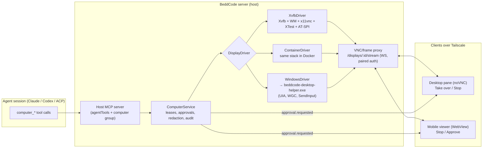
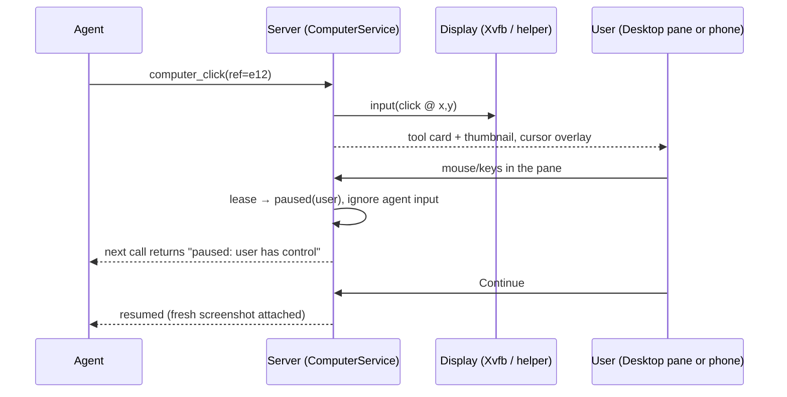

# PRD: Computer use for agents

Status: Windows driver on Cua built and tested (branch `spike/cua-driver`); Linux and container drivers
not started. Owner: 0xbasinas. Last updated: 28 October 2026.

Everything below the "What exists today" section is still the plan unless the section after this one
says it ships.

## Implemented: Windows host on Cua Driver

Code: `apps/server/src/computer/`. A session created with **Use computer** (`computerTools`) gets
`computer_*` tools from the host's MCP server. They run on the host, not on a desktop client.

- `driver.ts`: the `DesktopDriver` interface (windows, launch, snapshot, click, type, key, scroll).
- `cuaDriver.ts`: the driver on [`@trycua/cua-driver`](https://github.com/trycua/cua) 0.37 (MIT, an
  optional dependency, loaded lazily; the host reports why when it is missing or the host is not Windows).
- `computerTools.ts`: the policy: tools, approvals, grants, redaction, limits.

Policy that ships:

- An app the session opens is its own. An app that was already open is not, even when launching it
  returns that process (Notepad reopened the user's unsaved tabs in testing), and any other window
  needs the user's yes, once per program and session.
- Password managers and Windows security prompts are never operable and are not asked about.
- Refs (`e12`) are checked before use: the element row must be the one the agent last read, or the call is
  refused as stale. Cua only honours tokens from a window's latest snapshot, so each ref action re-reads the window.
- Fields named like passwords or secrets have their values replaced, and the picture is withheld.
- Typing a secret-looking string, typing into a password field, and system key combinations ask first.
- Typing is verified by reading the field back. Background input is tried first, with a foreground
  fallback (`foreground: auto|never|always`), which says so in the result.
- One call at a time (one mouse, one keyboard), 300 actions per session, and `revoke` on session end.

Measured on Windows 11 (Cua 0.37, Calculator, a throwaway Electron app, Windows Terminal):

| Finding                      | Detail                                                                                                                                                                                                                                                           |
| ---------------------------- | ---------------------------------------------------------------------------------------------------------------------------------------------------------------------------------------------------------------------------------------------------------------- |
| UIA clicks in the background | Reliable; 5–11 ms; no focus change.                                                                                                                                                                                                                              |
| Background typing            | Unreliable. It landed once in Calculator and not on a second try, and was ignored by Notepad. The SDK reports "not verified". Chromium and Windows Terminal refuse it outright.                                                                                  |
| Foreground typing            | SendInput works in simple fields; the driver restores the previous foreground. In Notepad it dropped and repeated characters ("Hello m BeddCode rrrrr..."), and a 25 ms pause per key still lost words ("Hello from BeddCode ...."). Always read the field back. |
| Setting a value              | `computer_type` with `clear: true` replaces an element's content through UI Automation: exact in Notepad (verified), no keystrokes, no focus change. Chromium fields do not support it.                                                                          |
| Electron                     | Only the title bar until Chromium accessibility is on: launch the app with `--force-renderer-accessibility`. Then the full DOM tree and background clicks work. `set_value` is not supported on Chromium fields.                                                 |
| Elevated windows             | The driver refuses with a clear UIPI error and returns almost nothing from `get_window_state`. Nothing is typed.                                                                                                                                                 |
| Screenshots                  | Clear PNGs per window, also of windows that are not in front.                                                                                                                                                                                                    |

Packaging: `apps/desktop/scripts/build-host.mjs` installs `@trycua/cua-driver` beside the host bundle on Windows builds
(about 31 MB on disk, outside the ASAR archive, copied by `after-pack.cjs` like the other native packages).
Checked with `pnpm run pack`: the packaged `BeddCode.exe`, run as Node, loads it and its health check passes.

Not done: the Desktop pane viewer, Stop and take-over, the phone viewer, redaction of pixels (only whole
pictures are withheld), per-project app allow lists, and the Linux and container drivers.

Tests: `computerTools.test.ts` and `cuaDriver.test.ts` (fake desktop and fake SDK client),
`agentTools.computer.test.ts`, and `computerTools.real.test.ts`, which drives Calculator through Cua
when `BEDDCODE_REAL_COMPUTER=1`.

## Executive summary

Browser use (PR #5, in review) lets agents drive the BeddCode browser pane through host MCP tools.
Computer use is the next step: an agent sees and operates a whole desktop. That covers native apps,
Electron apps (including BeddCode itself), installers, and GUI-only tools.

**Recommendation.**

1. **Ship a host-owned virtual display first, on Linux.** Run an Xvfb display, a light window
   manager and a VNC server on the host. The agent gets `computer_*` MCP tools: screenshot, click,
   type, key, scroll, drag, zoom, plus an accessibility snapshot where available. The server runs
   these tools **on the host**. The user watches and takes over in a new **Desktop pane**: noVNC
   over the existing BeddCode WebSocket, with no open VNC port. This fits the box, keeps the agent
   away from the user's real session, and makes the agent loop stay local to the host. Only the
   viewer stream crosses Tailscale.
2. **Add an optional container mode** with the same driver inside a Docker image, for isolation and
   disposable per-session desktops.
3. **Add a Windows driver later, opt-in, on the laptop.** It is a small helper in the user's logon
   session that uses UI Automation (the accessibility tree), Windows.Graphics.Capture and
   `SendInput`. Because it drives the real desktop, it is foreground-only, shows a visible banner,
   and pauses on any physical input. Windows Sandbox is the isolation option to evaluate.
4. **Don't depend on model-native computer-use tools.** BeddCode drives CLIs (Claude Code, Codex,
   ACP agents), not raw model APIs. So the Anthropic and OpenAI computer tools can't be injected.
   Claude Code's own built-in computer use is macOS-only in the CLI. One BeddCode MCP tool set that
   follows the same action words works for every provider.

Safety is part of the design, not a later add-on:

- A per-session opt-in.
- Approvals for launching apps and for sensitive keys.
- Redaction of password fields and user-marked windows before a screenshot reaches the model.
- Screen text treated as untrusted.
- A kill switch on desktop, phone and a hotkey.

## Goals and non-goals

**Goals**

- Let any BeddCode agent (Claude Code, Codex, Grok or another ACP agent) operate a GUI through one
  tool set.
- Let the user watch live, take over instantly, and hand back. This is the same model as browser
  use.
- Work on the box (Linux, often headless) and on the Windows laptop.
- Be usable from the phone over Tailscale: watch, stop, approve.
- Reuse the browser-use plumbing: host MCP tools, tool cards with thumbnails, the agent banner, the
  "Can use …" opt-in, and approvals relayed through each provider.

**Non-goals**

- macOS (out of scope per PLAN.md). The design doesn't block it.
- Replacing browser use. Web tasks stay on `browser_*` tools, which are faster and more precise.
  The Claude and Codex docs give the same advice: the most precise tool first, screen control last.
- Training or hosting a GUI model.
- Unattended control of the user's real Windows desktop while they are away (see the open
  questions).

## What exists today

| Piece                      | Where                                                                                                                                    | Reuse                                                                                                                                                                                                                   |
| -------------------------- | ---------------------------------------------------------------------------------------------------------------------------------------- | ----------------------------------------------------------------------------------------------------------------------------------------------------------------------------------------------------------------------- |
| Host MCP server for agents | `apps/server/src/automation/agentTools.ts`                                                                                               | Add a `computer` tool group next to agent tools and `browser_*`.                                                                                                                                                        |
| Browser use (PR #5)        | `apps/server/src/automation/browserUse.ts`, `apps/desktop/src/browserAgent.ts`, `apps/web/src/features/browser/*`, `BrowserToolCard.tsx` | Tool routing, approvals (`approval.requested`), take-over rules (agent paused on user input, injected input ignored for about 400 ms after it is sent), banner, grouped tool cards with thumbnails, per-session opt-in. |
| Approval plumbing          | Codex `default_tools_approval_mode`, ACP `isHostTool` auto-allow (PR #5)                                                                 | Computer tools that need approval use the same request/resolve flow.                                                                                                                                                    |
| Background service         | `apps/server/src/service/install.ts`                                                                                                     | Linux: a systemd **user** unit, so no `DISPLAY`. The server must start its own display. Windows: a scheduled task **at logon**, so it runs in the user's interactive session, which the Windows driver needs.           |
| Terminals                  | `apps/server/src/terminals/manager.ts`                                                                                                   | Precedent for long-lived host processes owned by a session.                                                                                                                                                             |
| Mobile app                 | `apps/mobile`                                                                                                                            | Needs a viewer (WebView with noVNC) and stop/approve actions.                                                                                                                                                           |

## Landscape and building blocks

### How others do it

| Product or API              | What it is                                                                                                                                                                                                        | Relevance                                                                                                                     | Source                                                                                                                                                                                                                                                                                                                       |
| --------------------------- | ----------------------------------------------------------------------------------------------------------------------------------------------------------------------------------------------------------------- | ----------------------------------------------------------------------------------------------------------------------------- | ---------------------------------------------------------------------------------------------------------------------------------------------------------------------------------------------------------------------------------------------------------------------------------------------------------------------------- |
| Anthropic computer use tool | A client toolset (`computer_toolset_20260801`) with member tools like `screenshot`, `left_click`, `type`, `zoom`. The application runs the actions. Earlier `computer_20251124` and `computer_20250124` are beta. | The action vocabulary to mirror. API-level, so not injectable into Claude Code.                                               | [docs](https://platform.claude.com/docs/en/agents-and-tools/tool-use/computer-use-tool), [tool reference](https://platform.claude.com/docs/en/agents-and-tools/tool-use/tool-reference)                                                                                                                                      |
| Claude Code computer use    | Desktop app: research preview on macOS and Windows, with per-app tiers (browsers view-only, terminals and IDEs click-only). CLI: a built-in `computer-use` MCP server, **macOS only**, interactive sessions only. | Can't be used by BeddCode on Windows or Linux. Per-app tiers are a good safety idea.                                          | [desktop](https://code.claude.com/docs/en/desktop), [CLI](https://code.claude.com/docs/en/computer-use), [Windows CLI request](https://github.com/anthropics/claude-code/issues/82300)                                                                                                                                       |
| OpenAI computer tool        | Responses API `tools: [{type: "computer"}]`. Batched `actions[]` (`click`, `double_click`, `drag`, `move`, `scroll`, `keypress`, `type`, `wait`, `screenshot`). `computer-use-preview` is shut down.              | The same action words. API-level.                                                                                             | [guide](https://developers.openai.com/api/docs/guides/tools-computer-use), [migration](https://developers.openai.com/api/docs/guides/tools-computer-use-integration)                                                                                                                                                         |
| Codex app computer use      | A plugin on macOS and Windows (not EEA, UK or Switzerland at launch). On Windows the target app must stay visible on the active desktop. Admin app allow and block rules.                                         | Confirms the Windows constraint: real-desktop control is foreground. App rules are worth copying. Not drivable from BeddCode. | [Codex docs mirror](https://spybara.com/openai/codex/history/docs/en/2026-05-28-1858..2026-05-29-1858/app/computer-use/), [admin controls](https://help.openai.com/en/articles/20001510-manage-browser-and-computer-use-in-your-enterprise-workspace), [announcement](https://openai.com/index/codex-for-almost-everything/) |
| Windows-MCP                 | An MIT MCP server: UI Automation tree, screenshots, mouse and keyboard, app control. Claims 0.2–0.5 s between actions.                                                                                            | A reference for a UIA-first tool set on Windows.                                                                              | [repo](https://github.com/CursorTouch/Windows-MCP)                                                                                                                                                                                                                                                                           |
| FlaUI-MCP                   | UIA snapshot with element refs (`windows_snapshot`, `windows_click ref=`), the Playwright-MCP pattern for desktop. A 30 s tool timeout. Electron support is partial.                                              | The ref-based design to copy for `computer_snapshot`.                                                                         | [repo](https://github.com/shanselman/FlaUI-MCP)                                                                                                                                                                                                                                                                              |
| UI-TARS-desktop             | ByteDance's GUI agent on a vision-language model, with local and remote operators                                                                                                                                 | An optional grounding model later                                                                                             | [repo](https://github.com/bytedance/UI-TARS-desktop)                                                                                                                                                                                                                                                                         |
| OmniParser                  | Microsoft screen parser: finds interactable regions and icon descriptions in screenshots                                                                                                                          | Optional set-of-marks for apps with no accessibility tree                                                                     | [repo](https://github.com/microsoft/OmniParser), [paper](https://arxiv.org/abs/2408.00203)                                                                                                                                                                                                                                   |
| Cua                         | MIT computer-use SDK and sandboxes: Linux containers (Docker or Podman), Linux and Windows VMs (QEMU, Hyper-V on Windows hosts)                                                                                   | A ready-made container and VM runtime to evaluate                                                                             | [repo](https://github.com/trycua/cua), [runtimes](https://cua.ai/docs/cua-sdk/guides/local-runtimes)                                                                                                                                                                                                                         |
| Synara                      | Gateway tokens with an optional `computer:control` capability                                                                                                                                                     | Capability-scoped access per session                                                                                          | [repo](https://github.com/Emanuele-web04/synara)                                                                                                                                                                                                                                                                             |
| Cursor cloud agents         | Cloud VMs with screenshot and video artifacts and remote desktop handoff to the human                                                                                                                             | Artifacts and take-over as a product norm                                                                                     | [docs](https://cursor.com/docs/cloud-agent)                                                                                                                                                                                                                                                                                  |

### Platform building blocks

| Block                                         | Platform                                      | Notes                                                                                                                                 | Source                                                                                                                                                                                                                                                                                       |
| --------------------------------------------- | --------------------------------------------- | ------------------------------------------------------------------------------------------------------------------------------------- | -------------------------------------------------------------------------------------------------------------------------------------------------------------------------------------------------------------------------------------------------------------------------------------------- |
| Xvfb                                          | Linux                                         | A headless X server. Any resolution. No GPU needed.                                                                                   | [man page](https://www.x.org/releases/current/doc/man/man1/Xvfb.1.xhtml)                                                                                                                                                                                                                     |
| x11vnc / TigerVNC (Xvnc)                      | Linux                                         | VNC server for an existing X display (x11vnc), or a combined X server plus VNC (Xvnc).                                                | [x11vnc](https://github.com/LibVNC/x11vnc), [TigerVNC](https://tigervnc.org/)                                                                                                                                                                                                                |
| noVNC                                         | Browser                                       | An HTML5 VNC client over WebSocket. Embeds in web, Electron and a React Native WebView.                                               | [repo](https://github.com/novnc/noVNC)                                                                                                                                                                                                                                                       |
| xdotool / XTest, AT-SPI                       | Linux                                         | Input injection, and the accessibility tree for GTK, Qt and Electron apps with accessibility on.                                      | [xdotool](https://github.com/jordansissel/xdotool), [AT-SPI](https://gitlab.gnome.org/GNOME/at-spi2-core)                                                                                                                                                                                    |
| UI Automation                                 | Windows                                       | The accessibility tree, control patterns (Invoke, Value, Toggle), `IsPassword`.                                                       | [UIA overview](https://learn.microsoft.com/en-us/windows/win32/winauto/entry-uiauto-win32)                                                                                                                                                                                                   |
| `SendInput`                                   | Windows                                       | Mouse and keyboard injection. **Blocked by UIPI** for higher-integrity (elevated) windows, and fails silently.                        | [SendInput](https://learn.microsoft.com/en-us/windows/win32/api/winuser/nf-winuser-sendinput), [UIA security](https://learn.microsoft.com/en-us/windows/win32/winauto/uiauto-securityoverview)                                                                                               |
| Windows.Graphics.Capture, Desktop Duplication | Windows                                       | Window or monitor capture. WGC can capture occluded windows. DXGI duplication gives low-latency full-monitor frames with dirty rects. | [WGC](https://learn.microsoft.com/en-us/windows/apps/develop/media-authoring-processing/screen-capture), [DXGI](https://learn.microsoft.com/en-us/windows/win32/direct3ddxgi/desktop-dup-api)                                                                                                |
| Windows Sandbox                               | Windows Pro, Enterprise, Education (not Home) | A disposable hypervisor-isolated desktop, configured with a `.wsb` file (networking, mapped folders, logon command).                  | [overview](https://learn.microsoft.com/en-us/windows/security/application-security/application-isolation/windows-sandbox/), [config](https://learn.microsoft.com/en-us/windows/security/application-security/application-isolation/windows-sandbox/windows-sandbox-configure-using-wsb-file) |

## Options

### A. Host virtual display (Linux): Xvfb, WM, VNC

The server starts `Xvfb :N` (from a reserved range, never an existing display), a light window
manager, and `x11vnc` on a Unix socket or loopback. It drives input with XTest, captures
screenshots from the X server, and reads AT-SPI when an app exposes it.

- Pros:
  - Isolated from the user's session.
  - Works headless on the box.
  - Cheap.
  - Many displays per host.
  - The agent loop is all local.
- Cons:
  - Linux apps only.
  - Shares the host user's files and network unless it is also sandboxed.
  - Some apps need GPU or D-Bus and session services.

### B. Containerised desktop

Option A's stack inside a Docker or Podman image, one container per display. A project worktree is
bind-mounted. Network is optional. Cua is a ready runtime to evaluate.

- Pros:
  - Real isolation (filesystem, network, processes).
  - Disposable.
  - The image is reproducible.
- Cons:
  - Needs Docker.
  - Image size.
  - The app under test must be installed in the image.
  - On the Windows laptop it means Docker Desktop or WSL2.

### C. Native Windows control (the user's real desktop)

A helper process in the logon session uses UIA for the tree and actions, WGC or DXGI for frames,
and `SendInput` for raw input.

- Pros:
  - Real Windows apps, including the BeddCode desktop build.
  - UIA gives semantic refs, often better than pixels.
- Cons:
  - Shares the user's mouse, keyboard and focus.
  - UIPI blocks elevated windows.
  - The UAC secure desktop and a locked screen can't be driven.
  - DPI and multi-monitor edge cases.
  - Highest risk.

### C2. Windows isolated desktop (Windows Sandbox or a Hyper-V VM)

Run the Windows helper inside a Sandbox or VM. Stream its frames to the pane.

- Pros:
  - Isolation.
  - The user keeps their own desktop.
- Cons:
  - Pro or Enterprise only for Sandbox.
  - Boot time.
  - The helper and the app must be installed on each boot (`LogonCommand`, mapped folders).
  - The host↔guest channel is new work. See the open questions.

### D. Delegate to provider-native computer use

Use Claude Desktop or the Codex app's own computer use.

- Pros: no work for us.
- Cons:
  - Not controllable from BeddCode sessions.
  - Claude's CLI version is macOS-only.
  - Codex's is an app plugin, not part of `codex app-server`'s MCP surface as far as we know (open
    question).
  - Nothing works across providers.

### E. Model-native API tools vs accessibility tree vs vision grounding

This is about **what the agent sees**, not where the display is:

- **Pixels and coordinates.** Screenshot, then click(x, y). Works for any app. Accuracy depends on
  the model's vision and the screenshot scale.
- **Accessibility tree.** UIA or AT-SPI snapshot with refs, then click(ref). Precise, cheaper in
  tokens, and robust to DPI. Fails on custom-drawn UIs, canvases and many games. Electron is partial.
- **Vision parser.** OmniParser or UI-TARS adds marks or boxes to the screenshot. Helps weak vision
  models. Costs a GPU and latency.

### Comparison

|                                   | A. Xvfb (Linux)                                     | B. Container                    | C. Windows real desktop                             | C2. Windows Sandbox/VM                  | D. Provider-native     |
| --------------------------------- | --------------------------------------------------- | ------------------------------- | --------------------------------------------------- | --------------------------------------- | ---------------------- |
| Works on the box (headless Linux) | ✅                                                  | ✅                              | ❌                                                  | ❌                                      | ❌                     |
| Works on the Windows laptop       | via WSL2/WSLg (open question)                       | via Docker Desktop/WSL2         | ✅                                                  | ✅ (Pro+)                               | Codex/Claude apps only |
| All providers                     | ✅                                                  | ✅                              | ✅                                                  | ✅                                      | ❌                     |
| Isolation from the user           | Medium (separate display, same user)                | High                            | **None**                                            | High                                    | Low                    |
| User can keep working             | ✅                                                  | ✅                              | ❌ (shared input)                                   | ✅                                      | Varies                 |
| Accessibility tree                | AT-SPI (partial)                                    | AT-SPI (partial)                | UIA (good)                                          | UIA (good)                              | n/a                    |
| Setup cost                        | Low (apt packages)                                  | Medium (image)                  | Medium (helper exe)                                 | High                                    | None                   |
| Build effort                      | Low–Medium                                          | Medium                          | Medium–High                                         | High                                    | n/a                    |
| Best for                          | Testing Linux/Electron builds, GUI tools on the box | Untrusted apps, reproducible QA | Windows-only apps, final checks on the real machine | Windows apps without risking the laptop | —                      |

## Recommended architecture

The key difference from browser use is **where the tool runs.**

- `browser_*` calls are routed from the host to a **desktop client**, because the browser lives in
  the Electron app.
- `computer_*` calls run **on the host**, because the display lives there: an Xvfb on the box, a
  container, or the Windows session of the laptop's own server.

Running on the host means:

- The screenshot→action loop never crosses Tailscale. Only the human's viewer does.
- It works when no desktop client is open, for example from a phone or a schedule.

### Components

| Component                                     | Responsibility                                                                                                                                                                                                                                                                                |
| --------------------------------------------- | --------------------------------------------------------------------------------------------------------------------------------------------------------------------------------------------------------------------------------------------------------------------------------------------- |
| `ComputerService`                             | Owns display **leases** (one writer session per display), routes tool calls to drivers, enforces approvals and limits, runs redaction, writes an audit trail (each action plus a thumbnail) into the session event stream as `tool.*` events.                                                 |
| `DisplayDriver` interface                     | `start(opts)`, `stop()`, `screenshot({region?, scale})`, `input(action)`, `snapshot()` (accessibility tree with refs, if supported), `windows()`, `launch(cmd)`, `streamUrl()`, `onUserInput(cb)`.                                                                                            |
| `XvfbDriver`                                  | Picks a free display number from a reserved range (default `:90`–`:99`) and checks that the lock file is free. It never reuses an existing display such as the box's `:2`. Starts Xvfb, a WM and x11vnc on a Unix socket. Input goes through XTest. Snapshots come from AT-SPI (best effort). |
| `ContainerDriver`                             | The same stack in an image (`beddcode/desktop`). The worktree is mounted read-write at `/work`, the network policy is set per lease, and the container is removed on release.                                                                                                                 |
| `WindowsDriver` and `beddcode-desktop-helper` | A small native helper (C#/.NET or Rust) started by the server in the same logon session. It talks over a named pipe with a per-boot secret. It runs at medium integrity and never elevated, so UIPI applies by design.                                                                        |
| Stream proxy                                  | WS endpoint `/displays/:id/stream` on the existing server port, behind the pairing guard. It bridges to the VNC Unix socket (A, B) or to helper frames (C). No VNC or extra port is exposed on Tailscale.                                                                                     |
| Desktop pane (web, desktop)                   | noVNC canvas, an agent cursor overlay, a banner (Agent is using this desktop: Take over / Stop / Continue), a display picker, and screenshots-in-timeline.                                                                                                                                    |
| Mobile viewer                                 | A WebView with noVNC in view-only mode by default. Tap **Take over** for touch input (P2). Stop and approvals are native buttons.                                                                                                                                                             |

### Tool surface

Names and fields follow the Anthropic and OpenAI action vocabulary, so models trained on those
APIs map them easily. Screenshots return as MCP image content, like browser screenshots in PR #5.

| Tool                                                  | Args                                                                                   | Approval (default mode)                                                            |
| ----------------------------------------------------- | -------------------------------------------------------------------------------------- | ---------------------------------------------------------------------------------- |
| `computer_open`                                       | `{kind?: 'virtual'\|'container'\|'windows', width?, height?, apps?[]}` → `{displayId}` | Yes (first use per session)                                                        |
| `computer_screenshot`                                 | `{displayId, region?, scale?}`                                                         | No                                                                                 |
| `computer_zoom`                                       | `{displayId, region}`. A full-res crop for small text.                                 | No                                                                                 |
| `computer_snapshot`                                   | `{displayId, window?}` → accessibility tree with refs (`e12`), roles, names, bounds    | No                                                                                 |
| `computer_click`                                      | `{displayId, x?, y?, ref?, button?, count?, modifiers?}`                               | No                                                                                 |
| `computer_type`                                       | `{displayId, text, ref?}`                                                              | Approval if the target is a password field or the text matches the secret patterns |
| `computer_key`                                        | `{displayId, keys}` (for example `ctrl+s`)                                             | Approval for system combos (`win+r`, `alt+f4` on non-owned windows, `ctrl+alt+*`)  |
| `computer_scroll` / `computer_drag` / `computer_move` | coordinates or ref                                                                     | No                                                                                 |
| `computer_wait`                                       | `{displayId, ms?, until?: {windowTitle?, ref?}}`                                       | No                                                                                 |
| `computer_launch`                                     | `{displayId, command \| app}`                                                          | Yes, unless the app is on the project's allowlist                                  |
| `computer_windows` / `computer_focus`                 | list and focus top-level windows                                                       | No                                                                                 |
| `computer_close`                                      | `{displayId}`. Releases the lease (and the container).                                 | No                                                                                 |

Rules:

- **Ref first.** The tool descriptions tell the model to prefer `computer_snapshot` plus `ref`, and to
  fall back to coordinates.
- **Coordinate space.** Coordinates are in the screenshot's pixel space. The server maps them to
  physical pixels (DPI on Windows) and records the scale in each result.
- **Low default resolution.** The default virtual display is 1280×800 to keep image tokens and
  coordinate error down. The best default per model is an open question for testing.
- **Batching.** One call can carry `actions[]` (the OpenAI style) to save round trips. The server
  runs them in order and stops on the first failure, as the Anthropic toolset does.

### Mapping onto providers

- **Claude Code and Codex.** The `computer_*` tools appear through the host MCP server, the same as
  `browser_*`. Approvals use the provider's own prompt where it has one. Otherwise they use
  BeddCode's `approval.requested` relay, as in PR #5.
- **ACP agents (Grok and others).** Host tools are auto-allowed through `isHostTool`. Tools that
  need approval go through the BeddCode approval card. Whether each ACP agent shows MCP image
  results to its model must be verified per agent (open question).
- **Per-session opt-in.** A **Can use computer** toggle, like **Can use browser**. It is off by
  default. Children inherit it only if the parent has it and the user allowed inheritance.
- **Flows.** A step can ask for `computer: virtual` (see [agent-orchestration.md](./agent-orchestration.md)),
  for example "launch the Electron build and click through onboarding", with screenshots as run
  artifacts.

### Viewer and take-over

- The same rules as browser use: any user input in the pane pauses the agent. Input injected by the
  agent is ignored for about 400 ms after it is sent, so its own echo doesn't trip the pause.
  **Continue** hands control back with a fresh screenshot.
- **Windows real desktop.** Physical input is detected with a low-level input hook in the helper
  (open question: hook vs. polling `GetLastInputInfo`). Any physical mouse or keyboard input pauses
  the agent at once. A topmost, click-through banner shows while the agent has control.
- A tool call made while paused returns a clear status. It never queues input silently.

### Performance and bandwidth over Tailscale

- **Agent loop.** Screenshots are taken and sent to the model from the host. With the box as host,
  the laptop and phone carry no agent traffic. Latency is model latency plus about 50–200 ms of
  local capture and input. This is an estimate to measure in phase 1.
- **Viewer.** VNC sends only damaged regions. noVNC can lower quality and compression and scale the
  view. Defaults over Tailscale:
  - The desktop pane uses adaptive quality.
  - The mobile viewer is view-only with lower quality.
  - Streams pause when the pane is hidden or the app is in the background.
- **Windows helper frames.** P1 uses JPEG frames over the WS with dirty rects from DXGI duplication.
  WebRTC or H.264 is P2 if JPEG proves too heavy. Measure first.
- **Budgets.** Cap viewer bandwidth per client (default 4 Mbit/s, configurable). Thumbnails in tool
  cards are small JPEGs (about 320 px wide) stored as attachments.
- **Direct vs relayed.** Tailscale picks direct or DERP-relayed paths. Relayed paths are slower. The
  pane shows a connection quality hint, using `tailnet.peers` data where it is available.

## Safety

| Risk                                          | Control                                                                                                                                                                                                                                                                                                                                                                                                              |
| --------------------------------------------- | -------------------------------------------------------------------------------------------------------------------------------------------------------------------------------------------------------------------------------------------------------------------------------------------------------------------------------------------------------------------------------------------------------------------- |
| Agent damages the user's real session         | Default to A or B (separate display or container). C (real desktop) needs an explicit per-session opt-in plus a per-session approval, and is never inherited by children.                                                                                                                                                                                                                                            |
| Agent acts on prompt injection in screen text | The tool descriptions and the system note say screen text is untrusted data. Consequential actions need approval: app launch, system keys, typing into password fields, typing text that matches secret patterns. The Claude and OpenAI docs both advise treating screen content as untrusted and confirming consequential actions.                                                                                  |
| Secrets in screenshots                        | **Redaction before the model sees a frame.** Black out the bounds of accessibility nodes with password roles (UIA `IsPassword`, AT-SPI `password text`). Also black out user-marked windows by title or process (for example the password manager) and user-drawn regions per display. Redaction applies to the model image and the stored thumbnail. The live viewer stays unredacted, because it is only the user. |
| Agent types secrets                           | The agent never receives vault secrets. Logins on a display are done by the user through take-over.                                                                                                                                                                                                                                                                                                                  |
| Elevation and UAC                             | The Windows helper runs at medium integrity. Elevated windows and the UAC secure desktop return `blocked: elevated window` (UIPI), and the agent is told to ask the user.                                                                                                                                                                                                                                            |
| Runaway loops                                 | Per-lease caps: max actions (default 300), max wall time (default 30 min, extendable through approval), max screenshots per minute. The same idle and loop detection as Flows.                                                                                                                                                                                                                                       |
| Lost control                                  | **Kill switch**: Stop in the pane and banner. A notification action on the phone. On Windows, a global hotkey (default `Ctrl+Alt+Shift+F12`, configurable). Killing the helper or display process ends all input at once. `sessions.interrupt` also releases the lease.                                                                                                                                              |
| Network exfiltration from a container         | ContainerDriver networking is `none` or allowlist by default. Opening it is a lease option that needs approval.                                                                                                                                                                                                                                                                                                      |
| Audit                                         | Every action is a `tool.*` event with args, the redacted thumbnail and the result. It shows in the transcript, so `read_transcript` and the user can review it.                                                                                                                                                                                                                                                      |
| Interference with existing setups             | Displays come only from the reserved range. Never attach to an existing display (for example the box's `:2`) or to the installed app. Ports are never exposed. Streams only go through the paired WS.                                                                                                                                                                                                                |

## Windows host specifics

- **Session.** The Windows service mode is a logon scheduled task, so the server and helper run in
  the interactive session. If the workstation is locked or the session is disconnected, capture and
  input fail. Tools return `unavailable: session locked`.
- **Foreground constraint.** As in the Codex app, the target app must be visible on the active
  desktop. WGC can capture occluded windows, but `SendInput` goes to the foreground. UIA patterns
  (Invoke, Value) can act without focus for many controls. That is a reason to go ref-first.
- **DPI.** The helper is per-monitor DPI aware. Screenshots are scaled to a logical size. The scale
  goes into every result.
- **Multi-monitor.** One monitor (or one window) per lease. The user picks it when opening.
- **UIPI and elevation.** See the safety table. `uiAccess` needs a signed binary installed under
  Program Files. It is out of scope.
- **Isolation options on the laptop:**
  - Windows Sandbox (C2). Pro or Enterprise only. Needs the helper inside the guest plus a
    host↔guest channel.
  - WSL2 with Xvfb (A inside WSL). Linux apps only.
  - Docker Desktop (B).
  - Which of these the laptop supports is an open question.
- **Packaging.** The helper ships with the desktop or server install for Windows and is signed with
  the same certificate as the app, if there is one (open question).

## Phased plan

| Phase                       | Scope                                                                                                                                                                                                                           | Exit criteria                                                                                                                                        |
| --------------------------- | ------------------------------------------------------------------------------------------------------------------------------------------------------------------------------------------------------------------------------- | ---------------------------------------------------------------------------------------------------------------------------------------------------- |
| 0 – Spike                   | XvfbDriver on the box. `computer_screenshot`, `click`, `type`, `key` as host MCP tools. Manual run with Claude, Codex and Grok opening `xterm` and a GTK app. Measure latency and token cost per step at 1024×768 and 1280×800. | All 3 providers complete a 10-step script. Numbers recorded.                                                                                         |
| 1 – Linux MVP               | Full tool surface. AT-SPI snapshot with refs. Desktop pane with noVNC through the WS proxy. Take-over. Approvals. Redaction (password roles plus marked windows). Kill switch. "Can use computer" opt-in. Audit thumbnails.     | E2E: an agent launches the BeddCode Electron build on `:9x`, completes onboarding, and the user takes over mid-run and hands back. No exposed ports. |
| 2 – Containers and mobile   | ContainerDriver (`beddcode/desktop` image), network policy, the mobile view-only viewer, Stop and approvals from the phone, Flows `computer:` steps with artifacts.                                                             | Same E2E inside a container. Phone stop under 2 s.                                                                                                   |
| 3 – Windows native          | `beddcode-desktop-helper` with UIA snapshot and refs, WGC/DXGI frames, SendInput, physical-input pause, banner, hotkey, DPI handling, frame streaming to the pane.                                                              | An agent drives Notepad and the BeddCode Windows build on the laptop. Pause on physical input in under 200 ms. Elevated windows are refused.         |
| 4 – Isolation and grounding | Windows Sandbox (or a Hyper-V or Cua VM) driver evaluation. Optional OmniParser marks for apps with no accessibility tree. App allow and block rules per project (Codex-style).                                                 | Decision record for C2. Grounding A/B on 3 custom-drawn apps.                                                                                        |

## Testing with real agents

- **Unit tests** cover action mapping (coordinate scaling, key-name normalization; reuse
  `browserAgentKeys` ideas), the redaction geometry, lease and pause state, approval decisions, and
  the display-number picker (never picks an existing lock file).
- **Driver integration tests** run XvfbDriver on CI (Ubuntu runners can install Xvfb). Start a
  display, launch `xmessage` or a tiny GTK fixture, click a button by ref and by coordinates, and
  assert the result. The Windows helper gets a CI smoke test against a WinForms fixture on the
  Windows runner, if UIA works there (open question for hosted runners).
- **Real-agent e2e** runs on the box and the laptop, not in CI, like PR #5. Scripted tasks:
  - Fill and save a form in a fixture app.
  - Find a setting three menus deep.
  - Recover from a modal dialog.
  - Refuse an injected on-screen instruction ("type your API key here") and ask for approval
    instead.
  - Run each with Claude, Codex and Grok. Record success, steps, time and image tokens.
- **Take-over tests.** User input in the pane during a run pauses the agent within one action. The
  agent's next call reports paused. Continue resumes.

## Success metrics

- Fixture task success rate per provider in the virtual display: target ≥ 80% (after phase 1).
- Median action round-trip on the host, excluding the model: < 300 ms.
- Viewer usable over a relayed Tailscale path on the phone: subjective check, with bandwidth below
  the cap.
- Zero redaction misses on the password fixture set.
- Kill switch to input stopped: < 1 s on every surface.

## Open questions

1. **ACP image results.** Do Grok and other ACP agents pass MCP image content to the model? If not,
   should `computer_screenshot` fall back to a text description from the accessibility snapshot?
2. **Best resolution per model.** Is the 1280×800 default right, or 1024×768? Measure in phase 0.
3. **Codex app-server computer use.** Does Codex expose its computer-use plugin through
   `codex app-server` or MCP? If it does, should BeddCode prefer it on Windows for Codex sessions?
   This is unverified.
4. **WSLg vs. Xvfb in WSL** for Linux apps on the laptop. Is it worth supporting, or is the box
   enough?
5. **Windows Sandbox channel.** How does the host talk to a helper in the guest: mapped folder,
   networking, or a socket? Startup time is unknown.
6. **Input hook.** Low-level hooks vs. `GetLastInputInfo` polling for take-over detection. Hooks are
   more immediate but more intrusive.
7. **Signing.** Is code signing needed for the helper to avoid SmartScreen and AV friction?
8. **Unattended use** on the real Windows desktop while the user is away. Allow it with the screen
   unlocked? The current proposal says no.
9. **Electron accessibility.** Electron apps expose accessibility only partially (FlaUI-MCP notes
   this). Does BeddCode's own app need `--force-renderer-accessibility` for good refs?

## Sources

- BeddCode: `docs/PLAN.md`, `apps/server/src/automation/agentTools.ts`,
  `apps/server/src/service/install.ts`, PR #5 browser-use files (in review).
- Anthropic computer use tool: https://platform.claude.com/docs/en/agents-and-tools/tool-use/computer-use-tool
- Anthropic tool reference: https://platform.claude.com/docs/en/agents-and-tools/tool-use/tool-reference
- Claude Code Desktop computer use: https://code.claude.com/docs/en/desktop
- Claude Code CLI computer use (macOS): https://code.claude.com/docs/en/computer-use
- OpenAI computer use: https://developers.openai.com/api/docs/guides/tools-computer-use
- OpenAI migration from preview: https://developers.openai.com/api/docs/guides/tools-computer-use-integration
- Codex app computer use (docs mirror): https://spybara.com/openai/codex/history/docs/en/2026-05-28-1858..2026-05-29-1858/app/computer-use/
- Codex admin controls: https://help.openai.com/en/articles/20001510-manage-browser-and-computer-use-in-your-enterprise-workspace
- Codex announcement: https://openai.com/index/codex-for-almost-everything/
- Windows-MCP: https://github.com/CursorTouch/Windows-MCP
- FlaUI-MCP: https://github.com/shanselman/FlaUI-MCP
- UI-TARS-desktop: https://github.com/bytedance/UI-TARS-desktop
- OmniParser: https://github.com/microsoft/OmniParser, https://arxiv.org/abs/2408.00203
- Cua: https://github.com/trycua/cua, https://cua.ai/docs/cua-sdk/guides/local-runtimes
- Synara: https://github.com/Emanuele-web04/synara
- Cursor cloud agents: https://cursor.com/docs/cloud-agent
- Xvfb: https://www.x.org/releases/current/doc/man/man1/Xvfb.1.xhtml
- x11vnc: https://github.com/LibVNC/x11vnc, TigerVNC: https://tigervnc.org/
- noVNC: https://github.com/novnc/noVNC
- xdotool: https://github.com/jordansissel/xdotool, AT-SPI: https://gitlab.gnome.org/GNOME/at-spi2-core
- UI Automation: https://learn.microsoft.com/en-us/windows/win32/winauto/entry-uiauto-win32
- SendInput: https://learn.microsoft.com/en-us/windows/win32/api/winuser/nf-winuser-sendinput
- UIA security (UIPI, uiAccess): https://learn.microsoft.com/en-us/windows/win32/winauto/uiauto-securityoverview
- Screen capture (WGC): https://learn.microsoft.com/en-us/windows/apps/develop/media-authoring-processing/screen-capture
- Desktop Duplication API: https://learn.microsoft.com/en-us/windows/win32/direct3ddxgi/desktop-dup-api
- Windows Sandbox: https://learn.microsoft.com/en-us/windows/security/application-security/application-isolation/windows-sandbox/
- Windows Sandbox config: https://learn.microsoft.com/en-us/windows/security/application-security/application-isolation/windows-sandbox/windows-sandbox-configure-using-wsb-file
